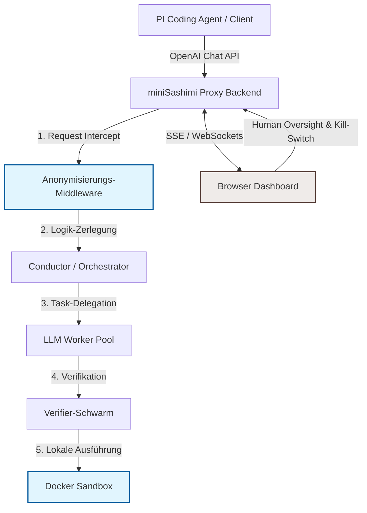

# ARCHITECTURE.md — miniSashimi

Dieses Dokument beschreibt die Enterprise-Architektur von **miniSashimi**, einem intelligenten Multi-Agenten-Proxy, der OpenAI-kompatible API-Calls entgegennimmt, diese in spezialisierte Workflows zerlegt, an einen diversifizierten LLM-Pool delegiert, validiert und über ein Browser-Dashboard verwaltet und überwacht.

---

## 1. Systemübersicht & Datenfluss

Der Client (z. B. ein lokaler Coding-Agent wie *PI Coding Agent*) kommuniziert mit `miniSashimi` über die standardisierte OpenAI-Schnittstelle. `miniSashimi` agiert als intelligenter Gateway-Proxy:



---

## 2. Enterprise-Verzeichnisbaum

Das Projekt ist nach den Prinzipien der **Hexagonalen Architektur (Ports & Adapters)** strukturiert. Dies isoliert die Kern-Orchestrierungslogik von den äußeren Schnittstellen (Webserver, Datenbanken, Docker-API, LLM-Clients) und ermöglicht KI-Coding-Agenten eine klare Orientierung.

```text
miniSashimi/
├── .agents/                    # Workspace-Customizations (Skills & Rules)
├── .github/
│   └── workflows/
│       └── ci-cd.yml           # CI/CD mit Trivy, Hadolint & Semgrep-Gates
├── terraform/                  # Infrastructure as Code (IaC)
│   ├── main.tf
│   ├── variables.tf
│   └── outputs.tf
├── app/                        # Anwendungs-Sourcecode
│   ├── __init__.py
│   ├── main.py                 # Einstiegspunkt (FastAPI)
│   ├── core/                   # Konfiguration, Logging, Secret Management
│   │   ├── config.py           # Pydantic Settings (Zero-Leak)
│   │   ├── logging.py          # Winston/Pino-artiges strukturiertes Logging mit Maskierung
│   │   └── security.py         # Krypto-Hilfsfunktionen (CSPRNG)
│   ├── domain/                 # Reines Domain Model & Business Logic (keine Frameworks)
│   │   ├── __init__.py
│   │   ├── models.py           # Core Entities (Workflow, Task, AgentState)
│   │   └── services.py         # Routing- und State-Maschine
│   ├── ports/                  # Interfaces (Eingangs- und Ausgangs-Ports)
│   │   ├── __init__.py
│   │   ├── inbound/            # Driver Ports (z. B. API, CLI, Dashboard-Controller)
│   │   └── outbound/           # Driven Ports (z. B. LLMClient, SandboxExecutor, StateRepository)
│   ├── adapters/               # Implementierung der Ports (Framework-abhängig)
│   │   ├── __init__.py
│   │   ├── inbound/
│   │   │   ├── api/            # FastAPI Router (OpenAI v1-kompatibel)
│   │   │   └── dashboard/      # WebSockets / SSE Server für das Dashboard
│   │   └── outbound/
│   │       ├── llm/            # API-Wrapper für OpenAI, DeepSeek, Qwen, GLM
│   │       ├── sandbox/        # Docker-API Integration (Isolierter Code-Executor)
│   │       └── storage/        # In-Memory oder SQLite Persistenz
│   └── middleware/             # Sicherheits- & Compliance-Filter
│       ├── __init__.py
│       ├── anonymizer.py       # Boundary Anonymization Middleware (GDPR)
│       └── rate_limit.py       # DoS-Schutz & Kosten-Governance
├── dashboard/                  # Frontend Browser-Dashboard (React + Vite + Vanilla CSS)
│   ├── index.html
│   ├── package.json
│   ├── src/
│   │   ├── main.jsx
│   │   ├── App.css
│   │   ├── components/         # Reusable UI Components
│   │   │   ├── AgentGraph/     # Workflow Visualisierung
│   │   │   ├── KillSwitch/     # Globaler Abbruch-Knopf
│   │   │   └── MetricsPanel/   # Token- & Kostenanzeige
│   │   └── hooks/
│   └── vite.config.js
├── docker/                     # Docker-Konfigurationen
│   ├── backend.Dockerfile      # Gehärtetes Image für den Proxy
│   └── sandbox.Dockerfile      # Maximal eingeschränktes Image für Code-Ausführung
├── docker-compose.yml          # Lokale Entwicklungsumgebung
├── Konzept.md
├── hintergrund.md
├── package.json
└── pyproject.toml
```

---

## 3. Kommentierte Kontrakte & Interfaces

### 3.1 Domain-Modelle & Datenschnittstellen (Pydantic / Python)

Die Definitionen sind typensicher und enthalten explizite Dokumentationsblöcke mit **Compliance-Tags**.

```python
"""
app/domain/models.py
Definiert die Kern-Datenstrukturen für die Orchestrierung und Compliance-Verfolgung.
"""
from typing import List, Dict, Optional, Any
from enum import Enum
from pydantic import BaseModel, Field, UUID4
from datetime import datetime

class Severity(str, Enum):
    CRITICAL = "KRITISCH"
    WARNING = "WARNUNG"
    OPTIMIZATION = "OPTIMIERUNG"
    GOOD_STANDARD = "Guter Standard"

class TaskStatus(str, Enum):
    PENDING = "PENDING"
    RUNNING = "RUNNING"
    COMPLETED = "COMPLETED"
    FAILED = "FAILED"
    ABORTED = "ABORTED"

class Task(BaseModel):
    """
    Repräsentiert einen einzelnen Arbeitsschritt, der vom Conductor generiert wurde.
    """
    id: UUID4 = Field(description="Eindeutige ID des Tasks")
    title: str = Field(..., description="Kurzbeschreibung des Tasks")
    assigned_model: str = Field(..., description="Zugewiesenes LLM-Modell (z.B. deepseek/deepseek-v4-pro)")
    payload: Dict[str, Any] = Field(..., description="Die an das Modell zu übergebenden Prompt-Daten")
    status: TaskStatus = Field(default=TaskStatus.PENDING)
    created_at: datetime = Field(default_factory=datetime.utcnow)
    completed_at: Optional[datetime] = None
    output: Optional[str] = None

class WorkflowState(BaseModel):
    """
    Repräsentiert den aktuellen Zustand eines Multi-Agenten-Laufs.
    @compliance EU-AI-Act-Art.14 (Menschliche Aufsicht ermöglicht den Stopp dieses Zustands)
    """
    workflow_id: UUID4 = Field(..., description="Eindeutige ID der Client-Anfrage")
    client_prompt: str = Field(..., description="Der ursprüngliche, eventuell anonymisierte Client-Prompt")
    tasks: List[Task] = Field(default_factory=list, description="Liste der generierten Subtasks")
    is_aborted: bool = Field(default=False, description="Flag, ob der Kill-Switch betätigt wurde")
    accumulated_cost_usd: float = Field(default=0.0, description="Kosten der verbrauchten Token")
    started_at: datetime = Field(default_factory=datetime.utcnow)
```

### 3.2 Ports & Interfaces (Abstraktionsschicht)

```python
"""
app/ports/outbound/llm_client.py
Definiert den Ausgangs-Port für LLM-Aufrufe. 
Alle externen Provider müssen dieses Interface implementieren.
"""
from abc import ABC, abstractmethod
from app.domain.models import Task

class LLMClientPort(ABC):
    @abstractmethod
    async def execute_task(self, task: Task, credentials_scope: Dict[str, str]) -> str:
        """
        Sendet einen Task an das zugewiesene Modell.
        @param task: Das auszuführende Task-Objekt.
        @param credentials_scope: Eingeschränkte API-Keys je nach Least-Privilege-Prinzip.
        @return: Die Antwort des Modells.
        @compliance OWASP-LLM06 (Sicherstellen, dass keine Host-Credentials übertragen werden)
        """
        pass

"""
app/ports/outbound/data_masker.py
Port für die Datenschutz-Middleware vor dem Verlassen der EU-Grenze.
"""
class DataMaskerPort(ABC):
    @abstractmethod
    def mask_sensitive_data(self, content: str) -> str:
        """
        Filtert PII (Namen, E-Mails, IPs, API-Keys) aus dem Text.
        @param content: Der rohe Prompt/Quellcode.
        @return: Der maskierte/anonymisierte Content.
        @compliance GDPR-Art.25 (Privacy by Design durch Boundary Anonymization)
        """
        pass
```

---

## 4. Compliance- & IaC-Vorgaben

### 4.1 Deployment-Härtung (Dockerfiles)

Um die Sicherheit gemäß **OWASP A02:2025** (Sicherheitskonfiguration) und **LLM06** (Excessive Agency / Sandbox-Ausbruch) zu gewährleisten, verwenden wir ein striktes Zwei-Container-Modell:

#### 1. backend.Dockerfile (Der Proxy-Server)
*   **Minimales Base-Image:** `python:3.11-slim`
*   **Non-Root-User:** Der Prozess läuft unter dem Benutzer `appuser` (UID 10001).
*   **Read-Only Root-FS:** Dateisystem ist read-only, temporäre Daten nur in geshapten `tmpfs`-Volumes.

```dockerfile
# backend.Dockerfile
FROM python:3.11-slim AS builder
WORKDIR /build
COPY requirements.txt .
RUN pip install --no-cache-dir --user -r requirements.txt

FROM python:3.11-slim
RUN groupadd -g 10001 appgroup && \
    useradd -u 10001 -g appgroup -s /bin/bash -m appuser
WORKDIR /app
COPY --from=builder /root/.local /home/appuser/.local
COPY ./app /app/app
ENV PATH=/home/appuser/.local/bin:$PATH
USER appuser
EXPOSE 8000
HEALTHCHECK --interval=30s --timeout=5s --start-period=5s --retries=3 \
  CMD curl -f http://localhost:8000/health || exit 1
ENTRYPOINT ["uvicorn", "app.main:app", "--host", "0.0.0.0", "--port", "8000"]
```

#### 2. sandbox.Dockerfile (Die Ausführungsumgebung für generierten Code)
*   **Volle Isolation:** Keine Netzwerkverbindung nach außen (`--network none` zur Laufzeit).
*   **Keine Privilegien:** `cap_drop: ALL`, `no-new-privileges: true`.
*   **Ressourcenlimits:** Streng limitiert auf CPU (z. B. 0.5 Cores) und RAM (z. B. 256MB), um DoS durch Endlosschleifen zu verhindern.

```dockerfile
# sandbox.Dockerfile
FROM alpine:3.19
RUN apk add --no-cache python3 py3-pip bash
RUN addgroup -g 10002 sandboxgroup && \
    adduser -u 10002 -G sandboxgroup -D -s /bin/sh sandboxuser
WORKDIR /workspace
USER sandboxuser
# Verhindert Schreibzugriff auf das Root-Dateisystem außerhalb von /workspace
VOLUME /workspace
```

### 4.2 IaC (Terraform) - Lokales Deployment
Für die lokale Docker-Infrastruktur definieren wir eine saubere Abstraktion mit sicheren Defaults.

```hcl
# terraform/main.tf
terraform {
  required_providers {
    docker = {
      source  = "kreuzwerker/docker"
      version = "~> 3.0.0"
    }
  }
}

provider "docker" {
  host = "unix:///var/run/docker.sock"
}

resource "docker_network" "private_network" {
  name = "sashimi_private"
  internal = true # Komplett isoliertes Netzwerk für Worker/Sandbox
}

resource "docker_network" "public_network" {
  name = "sashimi_public" # Nur der Proxy und das Dashboard hängen hier
}

resource "docker_container" "proxy" {
  name  = "sashimi_proxy"
  image = "minisashimi-backend:latest"
  networks_advanced {
    name = docker_network.public_network.name
  }
  networks_advanced {
    name = docker_network.private_network.name
  }
  ports {
    internal = 8000
    external = 8000
  }
  # Secrets werden zur Laufzeit injiziert (z. B. via Doppler CLI auf dem Host)
  # Keinesfalls im Terraform-State ablegen!
}
```

---

## 5. Risikomatrix (Compliance & Security)

| ID | Regulatorischer Kontext / Standard | Risiko / Bedrohung | Schadensmaß | Eintrittswahrscheinlichkeit | Schadensklasse (CVSS / Risikostufe) | Architektur-Guardrail / Mitigation |
| :--- | :--- | :--- | :--- | :--- | :--- | :--- |
| **R-01** | **EU AI Act (Art. 14 / Art. 50)** | Kontrollverlust durch unbegrenzte autonome Agenten-Loops (Infinite Loop / Halluzination). | Hoch | Mittel | **[WARNUNG]** (CVSS: 7.5) | **Human-in-the-Loop Dashboard:** Jeder kritische Schritt (Write auf Host-Dateisystem, Git-Commit) benötigt Bestätigung. **Kill-Switch** bricht Workflow sofort ab. **Token-Budget-Limits** verhindern Kosten-DoS (LLM10). |
| **R-02** | **DSGVO (Art. 25 & 32) / BDSG** | Abfluss personenbezogener Daten (PII) an LLM-Provider in Drittstaaten (USA, China). | Hoch | Hoch | **[KRITISCH]** (CVSS: 9.1) | **Boundary Anonymization Middleware:** Regex- und NLP-basierte Erkennung und Maskierung von Namen, IPs, Telefonnummern und Passwörtern auf Proxy-Ebene, *bevor* die Payload die Schnittstelle verlässt. |
| **R-03** | **OWASP LLM06 / A07:2025** | **Excessive Agency:** Der Sandbox-Container bricht aus oder greift unautorisiert auf Host-Ressourcen/Git-Keys zu. | Extrem | Mittel | **[KRITISCH]** (CVSS: 9.8) | **Isolierte Container-Sandbox:** Code-Ausführung erfolgt ausschließlich in temporären Docker-Containern ohne Root-Rechte, ohne Netzwerk (`--network none`) und mit `cap_drop: ALL`. |
| **R-04** | **OWASP A03:2025 / CRA** | **Supply Chain Failure:** Einbindung kompromittierter Python-Pakete oder verwundbarer LLM-SDKs. | Hoch | Mittel | **[WARNUNG]** (CVSS: 8.2) | **CRA-Compliance:** Automatisierter Trivy- & Hadolint-Scan in der CI/CD-Pipeline. Generierung einer standardisierten **SBOM (Software Bill of Materials)** via Syft bei jedem Release. Pinning aller Abhängigkeiten mit SHA-256-Hashes in der `pyproject.toml`. |
| **R-05** | **OWASP A04:2025 / Secrets** | **Hardcoded Secrets / Leakage:** API-Schlüssel für die LLM-Provider geraten in Logs oder Client-Antworten. | Extrem | Hoch | **[KRITISCH]** (CVSS: 9.3) | **Zero-Leak Policy:** API-Keys werden ausschließlich als Environment-Variablen über einen Secret-Manager injiziert. Eine **Log-Masking-Middleware** maskiert bekannte Key-Muster (z.B. `sk-`, `ghp_`) im gesamten System. |

---

*Version 1.0 — Stand: 2026-06-23. Erstellt im Rahmen des Greenfield-Designs für miniSashimi unter Einhaltung des `/codeultra`-Qualitätsstandards.*
