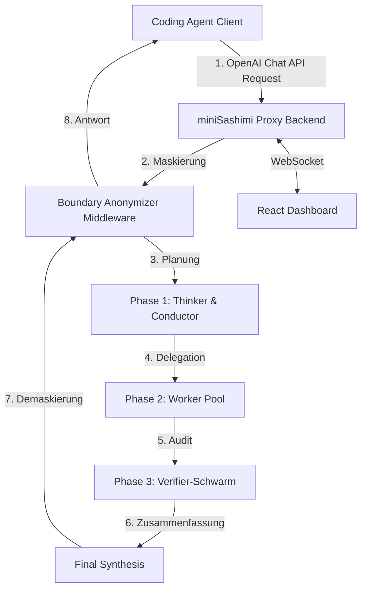

# miniSashimi 🍣

Ein intelligenter Multi-Agenten-Proxy für Coding-Agenten (wie *PI Coding Agent*, *Claude Code*, *Cline* uvm.) mit einem modernen Echtzeit-Browser-Dashboard.

`miniSashimi` schaltet sich als OpenAI-kompatibler API-Proxy zwischen deine Client-Coding-Agenten und deine LLM-Provider (OpenAI, Anthropic, Google, Mistral, OpenRouter, DeepSeek, **LM Studio**). Bei einer Anfrage startet `miniSashimi` eine koordinierte Multi-Agenten-Kette, teilt Aufgaben auf spezialisierte Worker-Modelle auf, führt Sicherheits-Audits durch und liefert ein optimiertes, verifiziertes Ergebnis zurück.

---

## ✨ Feature-Übersicht

| Feature | Beschreibung |
| :--- | :--- |
| **7 LLM-Provider** | OpenAI, Anthropic, Google, Mistral, OpenRouter, DeepSeek und **LM Studio** (lokale Modelle) |
| **13 konfigurierbare Modellrollen** | Jede Workflow-Phase kann individuell einem Provider + Modell zugewiesen werden |
| **Intelligentes Routing** | Automatisches Native↔OpenRouter-Upgrade/Fallback mit farbcodierten Status-Badges |
| **SSE Streaming** | Vollständige Streaming-Unterstützung für Chat Completions (`text/event-stream`) |
| **Tool Call Generation** | Automatische Konvertierung von `### FILE:`-Blöcken in OpenAI-kompatible `tool_calls` |
| **Test Mode** | Alle Tasks kostengünstig über `mistral/mistral-small-latest` routen |
| **Cost Tracking & Limiting** | Echtzeit-Kostenüberwachung mit konfigurierbarem USD-Limit (Warnung bei 80%, Abbruch bei 100%) |
| **Echtzeit-Dashboard** | Dark Glassmorphism-Design mit Live-Workflow-Monitoring, Log-Terminal und Settings |
| **Boundary Anonymizer** | PII-Maskierung (E-Mails, IPs, Namen, Kreditkarten, API-Keys) mit Runtime-Toggle |
| **Verschlüsselte Key-Ablage** | AES-128/Fernet + PBKDF2 (600k Iterationen) in SQLite |
| **Workflow-Persistenz** | Workflows in SQLite gespeichert, beim Neustart automatisch wiederhergestellt |
| **Docker-Ready** | `docker-compose up --build` inkl. Health Check und Ressourcenlimits |

---

## 🏗️ Systemarchitektur & Workflow-Phasen

`miniSashimi` folgt den Prinzipien der **Hexagonalen Architektur (Ports & Adapters)** (ausführlich dokumentiert in [ARCHITECTURE.md](ARCHITECTURE.md)). Dies trennt den Anwendungskern sauber von Webserver-Frameworks, Datenbank-Zugriffen und externen APIs.

Der gesamte Ablauf ist in vier Phasen unterteilt:



### Die Workflow-Phasen:

1. **Phase 1: Analyse & Strategie (Planungsebene)**
   - **Thinker (Systemarchitektur & Ablauf-Planung):** Zerlegt komplexe Aufgaben in granulare Teilschritte, entwirft Modulstrukturen und definiert API-Schnittstellen.
   - **Conductor (Tool-Auswahl & Workflow-Konstruktion):** Übersetzt die Strategie des Thinkers in eine strukturierte JSON-Taskliste mit Pydantic-Validierung und weist diese den spezialisierten Workern zu.

2. **Phase 2: Code-Synthese & Erstellung (Worker-Ebene)**
   - **Backend/Core Worker:** Implementiert Kernlogiken, Algorithmen und Datenbankanbindungen.
   - **Frontend Worker:** Gestaltet visuelle Web-Oberflächen und Layouts.
   - **Test Architect:** Schreibt parallel automatisierte Komponententests (z. B. Unit-Tests).
   - **Integration Worker:** Verbindet Einzelmodule und konfiguriert externe Schnittstellen.

3. **Phase 3: Qualitätssicherung & Verifikation (Review-Ebene)**
   - **Pre-Verifier:** Schneller Check auf Syntaxfehler oder unvollständige Codeblöcke.
   - **Security Auditor:** Scannt Code auf Sicherheitslücken (SQL-Injection, XSS, sensible Keys, OWASP Top 10) und bewertet Schwachstellen nach Schweregraden (`[KRITISCH]`, `[WARNUNG]`, `[OPTIMIERUNG]`) inklusive CWE-ID und CVSS-Score.
   - **Performance Scout:** Optimiert Komplexität und asynchrone Abläufe.
   - **Dependency Watchdog:** Prüft importierte Bibliotheken auf Aktualität und bekannte Schwachstellen.

4. **Phase 4: Ausführung & Evolution (Laufzeit-Ebene)** *(geplant)*
   - **Runtime Executor:** Führt den Code in einer isolierten Docker-Umgebung aus und fängt Fehlermeldungen für autonome Selbstheilungsschleifen ab.
   - **Repository Janitor:** Übernimmt das Branch- und Git-Management, behebt Merge-Konflikte und committet Code.

### 13 Konfigurierbare Modellrollen

Jede Rolle kann über das Dashboard individuell einem Provider + Modell zugewiesen werden:

| Rolle | Phase | Standard-Modell |
| :--- | :--- | :--- |
| Thinker | 1 - Planung | `openrouter/anthropic/claude-4.8-opus` |
| Conductor | 1 - Planung | `openrouter/mistralai/mistral-small-latest` |
| Backend Worker | 2 - Worker | `openrouter/openai/gpt-5.5` |
| Frontend Worker | 2 - Worker | `openrouter/zhipu/glm-5.2` |
| Test Architect | 2 - Worker | `openrouter/openai/gpt-5.5` |
| Integration Worker | 2 - Worker | `openrouter/openai/gpt-4o-mini` |
| Pre-Verifier | 3 - Verifikation | `openrouter/zhipu/glm-5.2` |
| Security Auditor | 3 - Verifikation | `openrouter/anthropic/claude-4.8-opus` |
| Performance Scout | 3 - Verifikation | `openrouter/openai/gpt-5.5` |
| Dependency Watchdog | 3 - Verifikation | `openrouter/anthropic/claude-4.6-sonnet` |
| Visual Verifier | 3 - Verifikation | `openrouter/openai/gpt-5.5` |
| Runtime Executor | 4 - Laufzeit | `openrouter/mistralai/mistral-small-latest` |
| Repository Janitor | 4 - Laufzeit | `openrouter/mistralai/mistral-small-latest` |

---

## 🤖 Intelligentes Provider-Routing

`miniSashimi` verfügt über ein mehrstufiges Routing-System, das automatisch den besten Weg zu jedem Modell findet:

### Routing-Logik

1. **Native Routing** — Wenn ein nativer API-Key für den Provider vorliegt (z. B. ein OpenAI-Key für `gpt-4o`), wird direkt geroutet
2. **OpenRouter→Native Upgrade** — Wenn ein OpenRouter-Modell konfiguriert ist (z. B. `openrouter/openai/gpt-5.5`), aber ein nativer OpenAI-Key existiert, wird automatisch nativ geroutet
3. **OpenRouter Fallback** — Wenn kein nativer Key existiert, aber ein OpenRouter-Key vorhanden ist, wird über OpenRouter geroutet
4. **Lokale Modelle (LM Studio, Ollama, llama.cpp)** — Modelle mit `lmstudio/`, `ollama/` oder `llama.cpp/` (auch `llamacpp` oder `llama.ccp`) benötigen keinen API-Key und werden an die entsprechende lokale Instanz geleitet.

### Routing-Badges im Dashboard

Das Dashboard zeigt farbcodierte Badges für jeden Routing-Status:

| Badge | Farbe | Bedeutung |
| :--- | :--- | :--- |
| **Native** ✅ | Grün | Direkter API-Key vorhanden |
| **OpenRouter** 🖥️ | Blau | Routing über OpenRouter mit Sub-Model |
| **Fallback** ⚠️ | Bernstein | Kein nativer Key, Fallback auf OpenRouter |
| **Local** 🖥️ | Lila | LM Studio, kein API-Key nötig |
| **Missing** ✖ | Rot | Weder Provider-Key noch OpenRouter konfiguriert |

### Zusätzliche Routing-Features

- **Reasoning-Model-Erkennung:** Modelle mit `o1-`, `o3-`, `thinking`, `reasoning` im Namen erhalten automatisch keinen `temperature`-Parameter
- **Temperatur-Fehler-Recovery:** Wenn ein Modell den `temperature`-Parameter ablehnt, wird der Request automatisch ohne diesen Parameter wiederholt
- **Exponential Backoff:** 3 Retry-Versuche (1s, 2s, 4s) bei transienten Fehlern; sofortiger Abbruch bei 401/403 Auth-Fehlern
- **Client-Caching:** Globaler OpenAI-Client-Cache und geteilter httpx-Client zur Vermeidung von Verbindungsoverhead

---

## 🖥️ Dashboard

Das Dashboard ist eine React 19-Anwendung mit einem **Dark Glassmorphism Theme** (Sashimi Coral `#ff6b6b` Akzentfarbe), gebaut mit Vite und Vanilla CSS. Es besteht aus zwei Hauptbereichen mit Sidebar-Navigation.

### 🔐 Login

- **Token-basierte Authentifizierung** — Login mit dem Dashboard-Token aus `~/.minisashimi/dashboard_token`
- **Auto-Verify** — Gespeicherte Tokens werden beim Laden automatisch via `GET /api/verify` verifiziert
- **Session-Expiry-Handling** — Automatischer Logout bei 401-Antworten von jeder API
- **Deutsche Fehlermeldungen** — „Ungültiger Access Token", „Verbindung zum Server fehlgeschlagen", „Sitzung abgelaufen"

### 📊 Workflows (Echtzeit-Monitoring)

- **Workflow-Liste (Sidebar)** — Reverse-chronologische Liste aller Workflows mit Smart-Datumslabels (Heute, Gestern, DD.MM.YYYY)
- **Status-Badges** — `COMPLETED`, `RUNNING`, `FAILED`, `ABORTED`, `PENDING`
- **Kostenanzeige** — Akkumulierte Kosten in USD pro Workflow
- **Task-Anzahl** — Anzahl der Tasks pro Workflow

#### Workflow-Detailansicht

- **Header** — Workflow-ID, Gesamt-Tokens, Kosten, Status-Badge
- **Token Usage Banner** — Input/Prompt-Tokens, Output/Completion-Tokens, Cache-Hit/Read-Tokens (bedingt), Gesamt-Tokens
- **Original-Client-Prompt** — Formatiertes Zitat-Block
- **Kill Loop Button** — Laufenden Workflow über `POST /api/workflows/{id}/abort` abbrechen

#### Task-Timeline (Visuelle Pipeline)

- **Vertikale Timeline** mit verbundenen farbcodierten Punkten (🟡 Running mit Puls-Animation, 🟢 Completed mit Glow, 🔴 Failed)
- **Task-Karten** — Titel, zugewiesenes Modell, Per-Task Token-Breakdown (prompt_tokens in / completion_tokens out + cache_read_tokens)
- **Collapsible Output** — Aufklappbare Task-Ausgabe via `<details>` mit Zeilenanzahl
- **Fehleranzeige** — Rot umrandetes Panel mit Fehlermeldung

### 📋 Live System Logs (Terminal Panel)

- **Aufklappbares Terminal-Panel** am unteren Rand der Workflow-Ansicht
- **Echtzeit-Log-Stream** — WebSocket-gespeister Live-Viewer; neue Einträge erscheinen sofort
- **Farbcodierte Log-Level** — `INFO` (grün), `WARNING` (bernstein), `ERROR` (rot/fett), `DEBUG` (lila)
- **Auto-Scroll** — Springt automatisch zum neuesten Eintrag
- **Log-Clear** — Button zum Leeren des lokalen Log-Puffers (max. 300 Einträge)
- **Monospace Font** — Fira Code / Courier New

### ⚙️ Settings

#### API Key Management
- **6 Provider** — API-Keys für OpenAI, Anthropic, Google, Mistral, OpenRouter, DeepSeek hinzufügen/bearbeiten/löschen
- **Maskierte Anzeige** — Passwort-Input mit verdeckten Werten
- **Save & Delete** — Einzelne Keys speichern oder mit Bestätigungsdialog löschen

#### Compliance & Sicherheits-Settings
- **PII Anonymisierung** — Toggle: Aktiviert (Empfohlen) / Deaktiviert
- **Kostenlimit pro Workflow** — Konfigurierbarer USD-Betrag (Standard: `$10.00`)
- **LLM Request Timeout** — Konfigurierbarer Timeout in Sekunden (Standard: `300`)
- **Test Mode** — Aktivierbar, routet alle Tasks über `mistral/mistral-small-latest` für kostengünstige Tests; zeigt Warnung bei fehlendem Mistral-Key
- **LM Studio Base-URL** — Eingabefeld mit Standard-Hint `http://127.0.0.1:1234/v1`

#### Model Routing Konfiguration
- **Per-Phase Routing** — Individuelle Provider+Modell-Zuweisung für jede Workflow-Rolle
- **Routing Badges** — Farbcodierte Anzeige des Routing-Status (Native/OpenRouter/Fallback/Local/Missing) pro Rolle
- **Unsaved Changes Warning** — Gelbes Warnbanner bei ungespeicherten Änderungen

#### System-Aktionen
- **Workflow-Historie löschen** — Löscht abgeschlossene Workflows (behält laufende/wartende bei)

### 🎨 UI/UX Design

- **Dark Glassmorphism Theme** — Frosted-Glass-Effekte mit `backdrop-filter: blur(12px)`, Radial-Gradient-Hintergründe
- **Sashimi Coral** — Akzentfarbe `#ff6b6b` mit Gradient zu `#ff8e53`
- **CSS Design Tokens** — Vollständiges Design-System mit CSS Custom Properties
- **Micro-Animationen** — Fade-in, Hover-Transforms, Puls-Animationen, sanfte Übergänge
- **Responsive Layout** — Mobile-first mit Breakpoints bei 768px und 1024px
- **Google Fonts (Outfit)** — Moderne Typografie (Weights 300–800)
- **Custom Scrollbar** — Individuell gestylte Scrollbars
- **Connection Indicator** — Grüner/roter Punkt mit „Proxy Online"/„Proxy Offline" Text
- **Test Mode Banner** — Gelbes Warnbanner mit pulsierendem ⚠️-Icon bei aktivem Test Mode

---

## 🔌 API-Endpunkte

### OpenAI-kompatible Endpunkte

| Endpunkt | Methode | Beschreibung |
| :--- | :--- | :--- |
| `/v1/chat/completions` | `POST` | Chat Completions (Streaming & Non-Streaming) mit Tool Call Generation |
| `/v1/models` | `GET` | *(Reserviert)* Modell-Listing |

### Dashboard-API

| Endpunkt | Methode | Beschreibung |
| :--- | :--- | :--- |
| `/api/verify` | `GET` | Dashboard-Token verifizieren |
| `/api/ws-ticket` | `POST` | Kurzlebiges WebSocket-Auth-Ticket generieren (10s TTL) |
| `/api/keys` | `GET` | Alle Provider und deren Key-Konfigurationsstatus auflisten (maskiert) |
| `/api/keys/{provider}` | `POST` | API-Key für einen Provider speichern/aktualisieren |
| `/api/keys/{provider}` | `DELETE` | API-Key für einen Provider löschen |
| `/api/settings` | `GET` | Alle System-Settings abrufen |
| `/api/settings` | `POST` | System-Settings aktualisieren |
| `/api/workflows` | `GET` | Alle Workflows mit vollständigem State auflisten |
| `/api/workflows` | `DELETE` | Workflow-Historie löschen (laufende/wartende bleiben erhalten) |
| `/api/workflows/{id}/abort` | `POST` | Laufenden Workflow abbrechen |

### System

| Endpunkt | Methode | Beschreibung |
| :--- | :--- | :--- |
| `/health` | `GET` | Health Check (`{"status":"ok"}`) — auch als Docker Health Check genutzt |
| `/ws` | `WebSocket` | Echtzeit-Event-Stream (Workflow-Updates, Log-Streaming, Ping/Pong) |

---

## 🔄 Tool Call Generation

`miniSashimi` kann die Ausgaben der LLM-Pipeline automatisch in OpenAI-kompatible `tool_calls` konvertieren. Wenn die Agenten Code-Dateien im Format `### FILE: <pfad>` mit Code-Blöcken generieren, werden diese automatisch zu `write`/`write_file`/`writeFile`-Tool-Calls im Response umgewandelt. Zusätzlich erkennt `miniSashimi` wenn der letzte Client-Request ein `role: tool`-Message ist und verhindert damit Endlosschleifen.

---

## 🤖 Lokale Modell-Integrationen (LM Studio, Ollama, llama.cpp)

`miniSashimi` unterstützt lokale LLM-Provider wie **LM Studio**, **Ollama** und **llama.cpp**. Damit lassen sich lokal gehostete Modelle nahtlos in die Multi-Agenten-Pipeline einbinden:

1. **Lokalen Server starten** und ein Modell laden
2. Im Dashboard unter **Settings** die entsprechende Base-URL eintragen (z. B. `lmstudio_base_url` standardmäßig `http://127.0.0.1:1234/v1`, `ollama_base_url` standardmäßig `http://127.0.0.1:11434/v1`, oder `llama_cpp_base_url` standardmäßig `http://127.0.0.1:8080/v1`)
3. Bei der **Model Routing**-Konfiguration ein Modell mit dem passenden Prefix eintragen:
   - `lmstudio/dein-modell`
   - `ollama/dein-modell`
   - `llama.cpp/dein-modell` (Alternativ auch `llama.ccp/dein-modell` oder `llamacpp/dein-modell`)
4. Lokale Modelle benötigen **keinen API-Key**
5. Im Dashboard wird das Routing als **Local** (lila Badge) angezeigt

---

## 🧪 Test Mode

Der Test Mode ermöglicht kostengünstiges Testen der gesamten Pipeline:

- **Aktivierung:** Im Dashboard unter Settings → Test Mode → „Aktiviert"
- **Effekt:** Alle Tasks werden über `mistral/mistral-small-latest` geroutet, unabhängig von der konfigurierten Modellzuweisung
- **Voraussetzung:** Ein Mistral API-Key muss konfiguriert sein (Dashboard warnt bei fehlendem Key)
- **Visuell:** Gelbes Warnbanner im Dashboard + Header-Badge „Test aktiv"

---

## 💰 Cost Tracking & Limiting

`miniSashimi` verfolgt die Kosten jedes Workflows in Echtzeit:

- **Per-Model Kostenberechnung** — Unterschiedliche Raten für GPT-4, DeepSeek, Mistral-small, Gemini Pro/Flash etc.
- **Token-Tracking** — Prompt-, Completion-, Total- und Cache-Read-Tokens pro Task und pro Workflow
- **Kostenlimit** — Konfigurierbares USD-Limit pro Workflow (Standard: `$10.00`)
  - **Warnung bei 80%** — Log-Warnung wenn 80% des Limits erreicht sind
  - **Abbruch bei 100%** — Workflow wird automatisch abgebrochen wenn das Limit überschritten wird
- **Dashboard-Anzeige** — Akkumulierte Kosten pro Workflow in der Sidebar und Detailansicht

---

## 🛡️ Security & Compliance (Secure by Design)

Das System wurde nach dem Prinzip "Assume Breach" und mit strengen Security-Guardrails gehärtet:

*   **Boundary Anonymization Middleware:** Erkennt und maskiert personenbezogene Daten (PII) wie E-Mails, IP-Adressen, Namen, Telefonnummern, Kreditkarten und Postanschriften sowie API-Keys, bevor diese die europäische Datengrenze in Richtung Drittland-LLMs verlassen. Vor der Rückgabe an den Client werden die Daten wieder demaskiert. **Zur Laufzeit per Feature-Toggle ein-/ausschaltbar.**
*   **Zero-Leak Logging:** Alle Logs durchlaufen einen `SecretRedactingFilter` (Log-Masking-Middleware), um zu verhindern, dass sensible API-Keys, Tokens oder Zugangsdaten im Logfile (`~/.minisashimi/audit.log` oder in der Standardausgabe) landen (CWE-532).
*   **Kryptographisch sichere API-Key-Ablage:** Externe API-Keys werden symmetrisch verschlüsselt (AES-128 via `cryptography.fernet.Fernet` und PBKDF2HMAC mit 600.000 Iterationen) in einer lokalen SQLite-Datenbank abgelegt. Der Schlüssel wird in der lokalen Datei `.enc_key` abgelegt und darf **niemals** eingecheckt werden.
*   **SQLite mit WAL-Modus:** Write-Ahead-Logging für performante parallele Lesezugriffe, Thread-safe über `threading.Lock`.
*   **Information Leakage Prevention:** Generische Fehlermeldungen in HTTP-500-Responses (CWE-209).
*   **Client Disconnect Monitoring:** Erkennt abgebrochene HTTP-Verbindungen und bricht den zugehörigen Workflow ab.
*   **Absicherung des Web-Dashboards:**
    *   **Zustandslose WebSocket-Tickets:** Die WebSocket-Verbindung wird durch kurzlebige, einmalige Autorisierungs-Tickets (10s TTL) vor Session-Hijacking und CSRF geschützt.
    *   **WebSocket Auto-Reconnect:** Automatische Wiederverbindung mit 3-Sekunden-Delay bei Verbindungsverlust.
    *   **WebSocket Rate Limiter:** Limitiert auf maximal 10 aktive WebSocket-Verbindungen insgesamt und maximal 3 Verbindungen pro IP-Adresse zum Schutz vor Denial of Service (DoS) (CWE-400).
    *   **API Rate Limiter:** Schützt das Backend vor Überlastung mit einem Speicherlimit von maximal 10.000 überwachten Client-IDs zur Vermeidung von Out-of-Memory (OOM) Abstürzen. Periodischer Hintergrund-Cleanup inaktiver Client-IDs.
    *   **Restriktive Zugriffsrechte:** Das Dashboard-Token wird automatisch beim ersten Start erzeugt und mit restriktiven Berechtigungen (`0o600`) unter `~/.minisashimi/dashboard_token` abgelegt.
    *   **Constant-Time Token Vergleich:** Verwendet `secrets.compare_digest` für Bearer-Token-Validierung.
    *   **HTTP Security Header:** Standardmäßige Auslieferung von Headers wie `X-Frame-Options: DENY`, `X-Content-Type-Options: nosniff`, `Content-Security-Policy` (CSP), `Referrer-Policy` und `Strict-Transport-Security` (HSTS).
*   **Integritäts-Audit-Logs:** Revisionssicheres, HMAC-SHA256-signiertes Logbuch aller administrativen und sicherheitsrelevanten Vorgänge.
*   **Swagger/OpenAPI deaktiviert in Produktion:** Wenn `SASHIMI_ENV=production`, werden Swagger UI, ReDoc und das OpenAPI-Schema automatisch deaktiviert.

Weitere Details zur Sicherheitsarchitektur und behobenen Lücken findest du im [REMEDIATION_REPORT.md](REMEDIATION_REPORT.md) sowie in der [SECURITY.md](SECURITY.md).

---

## ⚙️ Konfiguration

### Umgebungsvariablen

Die Basiskonfiguration erfolgt über Umgebungsvariablen (auch via `.env`-Datei unterstützt):

| Variable | Beschreibung | Standardwert |
| :--- | :--- | :--- |
| `SASHIMI_ENV` | Umgebungstyp. `production` deaktiviert Swagger UI und OpenAPI-Docs. | `production` |
| `SASHIMI_ALLOWED_ORIGINS`| Erlaubte CORS-Origins für das Frontend (kommagetrennt). | `http://localhost:5173,http://127.0.0.1:5173` |
| `SASHIMI_DASHBOARD_TOKEN`| Token für den Dashboard-Zugriff und die Client-Authentifizierung. | *Wird bei Erststart generiert* |
| `SASHIMI_ENCRYPTION_KEY` | Manueller AES-Schlüssel für die SQLite-Verschlüsselung (Fernet). | *Wird bei Erststart generiert* |
| `SASHIMI_ENCRYPTION_SALT`| Salt für die Key-Derivation (PBKDF2). | *Wird bei Erststart generiert* |
| `SASHIMI_KEYS_DIR` | Verzeichnis zur Ablage sicherer Token/Verschlüsselungsdateien. | `~/.minisashimi` |
| `SASHIMI_AUDIT_DIR` | Speicherort für das signierte Audit-Log (`audit.log`). | `~/.minisashimi` |
| `SASHIMI_RATE_LIMIT_REQUESTS`| Maximale Anfragen pro Zeitfenster für den API Rate Limiter. | `60` |
| `SASHIMI_RATE_LIMIT_WINDOW`  | Zeitfenster in Sekunden für den API Rate Limiter. | `60` |

### Dashboard-Settings (SQLite-persistiert)

Erweiterte Einstellungen werden über das Dashboard verwaltet und in SQLite persistiert:

| Setting | Beschreibung | Standard |
| :--- | :--- | :--- |
| Provider API Keys | Verschlüsselte API-Keys für jeden der 6 Provider | *Nicht gesetzt* |
| `lmstudio_base_url` | URL der lokalen LM Studio Instanz | `http://127.0.0.1:1234/v1` |
| `ollama_base_url` | URL der lokalen Ollama Instanz | `http://127.0.0.1:11434/v1` |
| `llama_cpp_base_url` | URL der lokalen llama.cpp Instanz | `http://127.0.0.1:8080/v1` |
| `pii_masking_enabled` | Boundary Anonymizer zur Laufzeit ein/aus | `true` |
| `cost_limit_usd` | Maximales Kostenlimit pro Workflow in USD | `10.0` |
| `llm_timeout_seconds` | Timeout für LLM-API-Aufrufe in Sekunden | `300` |
| `test_mode_enabled` | Test Mode — alle Tasks über `mistral-small-latest` | `false` |
| `model_*` | Per-Phase Modellzuweisungen (13 Rollen, s. oben) | *Siehe Modellrollen-Tabelle* |

---

## 🚀 Setup & Ausführung

Stelle sicher, dass du Python 3.10+ und Node.js (v18+) auf deinem System installiert hast.

### Option A: Lokaler Start (Ohne Docker)

#### 1. Backend starten (Terminal 1)

1.  Abhängigkeiten installieren (in der virtuellen Umgebung `.venv`):
    ```bash
    .venv/bin/pip install -r requirements.txt
    ```
2.  Server starten:
    ```bash
    .venv/bin/uvicorn app.main:app --reload --port 8000
    ```
    *Hinweis:* Das Backend generiert automatisch beim Start das Dashboard-Token und speichert es unter `~/.minisashimi/dashboard_token`.

#### 2. Frontend Dashboard starten (Terminal 2)

1.  In den Dashboard-Ordner wechseln:
    ```bash
    cd dashboard
    ```
2.  Dependencies installieren (nur beim ersten Mal nötig):
    ```bash
    npm install
    ```
3.  Vite Dev-Server starten:
    ```bash
    npm run dev
    ```
4.  Öffne **`http://localhost:5173`** im Browser.
5.  Melde dich mit dem generierten Dashboard-Token an.

---

### 🔄 Proxy & Dashboard neu starten (Schnellstart)

Wenn die Server gestoppt wurden und du `miniSashimi` erneut starten möchtest, öffne zwei Terminals im Hauptverzeichnis des Projekts und führe Folgendes aus:

*   **Terminal 1 (Backend):**
    ```bash
    .venv/bin/uvicorn app.main:app --reload --port 8000
    ```
*   **Terminal 2 (Dashboard):**
    ```bash
    cd dashboard
    npm run dev
    ```

---

### Option B: Docker Setup

Wenn Docker und Docker Compose auf deinem System installiert sind, kannst du beide Services mit einem Befehl starten:

```bash
docker-compose up --build
```

Die SQLite-Datenbank und die Schlüssel werden in einem Docker-Volume (`db_data`) persistiert.

**Docker-Features:**
- `/health`-Endpunkt als Health Check
- Ressourcenlimits: Backend (1 CPU, 1GB RAM), Dashboard (0.5 CPU, 512MB RAM)
- Dashboard läuft als Non-Root-User (`node`)
- `restart: unless-stopped` für automatischen Neustart

---

## 🛠️ Konfiguration deines Coding-Agents

Um deinen Client-Agenten (z. B. *PI Coding Agent*, *Claude Code*, *Cline*, *Aider* etc.) über den intelligenten `miniSashimi` Proxy laufen zu lassen, konfiguriere diesen wie folgt:

*   **API Base URL / Endpoint:** `http://localhost:8000/v1`
*   **API Key / Bearer Token:** Verwende dein generiertes Dashboard-Token (aus `~/.minisashimi/dashboard_token` oder der Umgebungsvariable `SASHIMI_DASHBOARD_TOKEN`). Der Proxy prüft diese Autorisierung an den Endpunkten ab.
*   **Modell:** Ein beliebiger String (z. B. `gpt-4o`). Das tatsächliche Routing und die Zuordnung von Modellen pro Phase nimmst du bequem im miniSashimi Dashboard vor.

---

## 🧪 Unit- und Regressionstests

`miniSashimi` verfügt über eine Testsuite, die Kernkomponenten wie den `Anonymizer`, den `RateLimiter` und die krypto-grafischen Speicherroutinen prüft.

Führe die Tests einfach mit folgendem Befehl aus:

```bash
python tests/run_tests.py
```

Alle Unit-Tests verwenden temporäre Ordner (`tempfile.TemporaryDirectory`), um keine lokalen Konfigurations- oder Produktionsdaten zu überschreiben.

---

## 🗂️ Projektstruktur

```
miniSashimi/
├── app/
│   ├── main.py                 # FastAPI-App, REST-Endpunkte, WebSocket, Middleware
│   ├── adapters/
│   │   └── outbound/
│   │       └── llm/
│   │           └── client.py   # Multi-Provider LLM-Client mit intelligentem Routing
│   ├── core/
│   │   ├── database.py         # SQLite-Zugriff (WAL), verschlüsselte Keys, Settings, Workflows
│   │   └── security.py         # Fernet-Verschlüsselung, Audit-Logs, SecretRedactingFilter
│   ├── domain/
│   │   └── models.py           # Pydantic-Modelle (ChatCompletion, Task, WorkflowState)
│   ├── middleware/
│   │   └── anonymizer.py       # PII-Maskierung (Boundary Anonymizer)
│   └── orchestrator/
│       └── engine.py           # Multi-Agenten-Orchestrierung, Phase-Routing, Streaming
├── dashboard/
│   └── src/
│       ├── App.jsx             # React-Dashboard (Workflows + Settings)
│       ├── App.css             # Glassmorphism Design-System (Sashimi Coral)
│       ├── main.jsx            # React-Einstiegspunkt
│       └── index.css           # Basis-Styles + Google Fonts (Outfit)
├── docker/                     # Docker-Konfigurationsdateien
├── tests/                      # Unit- und Regressionstests
├── docker-compose.yml          # Docker Compose Setup mit Ressourcenlimits
├── requirements.txt            # Python-Abhängigkeiten
├── ARCHITECTURE.md             # Hexagonale Architektur-Dokumentation
├── SECURITY.md                 # Sicherheitsrichtlinien
└── REMEDIATION_REPORT.md       # Behobene Sicherheitslücken
```

---

## 📦 Tech Stack

| Komponente | Technologie |
| :--- | :--- |
| Backend | Python 3.10+, FastAPI, Uvicorn |
| LLM-Client | OpenAI SDK (AsyncOpenAI), httpx (Anthropic native) |
| Frontend | React 19, Vite 8, Vanilla CSS, Lucide Icons |
| Datenbank | SQLite (WAL-Modus) mit SQLModel ORM |
| Verschlüsselung | cryptography (Fernet, PBKDF2HMAC) |
| Validierung | Pydantic, pydantic-settings |
| Container | Docker, Docker Compose |
| Sonstiges | python-dotenv, aiofiles, websockets, bleach |

---

## 🔧 Hintergrund-Tasks

Das Backend startet folgende automatische Hintergrund-Tasks:

| Task | Intervall | Beschreibung |
| :--- | :--- | :--- |
| Rate Limiter Cleanup | Periodisch | Bereinigt inaktive Client-IDs aus dem Rate Limiter |
| WebSocket Ticket Cleanup | 60 Sekunden | Entfernt abgelaufene Einmal-Tickets |
| Workflow Cleanup | 5 Minuten | Entfernt abgeschlossene Workflows (>1h) und stale Workflows (>4h) |
| WebSocket Log Handler | On Startup | Bindet Log-Handler an root-, minisashimi- und uvicorn-Logger für Live-Streaming |

---

## 📝 Datenbank-Schema

| Tabelle | Felder | Beschreibung |
| :--- | :--- | :--- |
| `api_keys` | `id`, `provider` (unique, indexed), `encrypted_key`, `updated_at` | Verschlüsselte Provider-API-Keys |
| `settings` | `id`, `key` (unique, indexed), `value`, `updated_at` | System-Settings (JSON) |
| `workflows` | `workflow_id` (PK, indexed), `state_json`, `updated_at` | Persistierte Workflow-States |

---
*Erstellt im Rahmen des /codeultra Greenfield-Designs.*
