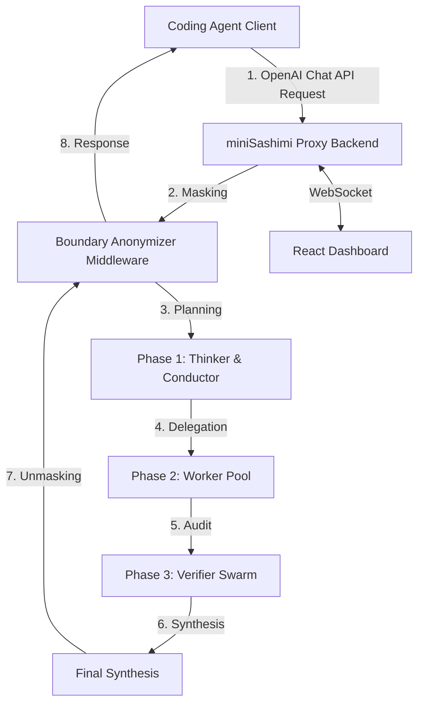

# miniSashimi 🍣

An intelligent multi-agent proxy for coding agents (such as *PI Coding Agent*, *Claude Code*, *Cline*, and many more) featuring a modern real-time browser dashboard.

`miniSashimi` sits as an OpenAI-compatible API proxy between your client coding agents and your LLM providers (OpenAI, Anthropic, Google, Mistral, OpenRouter, DeepSeek, **LM Studio**). When a request is made, `miniSashimi` initiates a coordinated multi-agent chain, delegates tasks to specialized worker models, performs security audits, and returns an optimized, verified result.

---

## ✨ Features Overview

| Feature | Description |
| :--- | :--- |
| **7 LLM Providers** | OpenAI, Anthropic, Google, Mistral, OpenRouter, DeepSeek, and **LM Studio** (local models) |
| **13 Configurable Model Roles** | Each workflow phase can be individually assigned to a provider + model |
| **Intelligent Routing** | Automatic Native↔OpenRouter upgrade/fallback with color-coded status badges |
| **SSE Streaming** | Full streaming support for Chat Completions (`text/event-stream`) |
| **Tool Call Generation** | Automatic conversion of `### FILE:` blocks into OpenAI-compatible `tool_calls` |
| **Test Mode** | Route all tasks cost-effectively through `mistral/mistral-small-latest` |
| **Cost Tracking & Limiting** | Real-time cost monitoring with a configurable USD limit (warning at 80%, abort at 100%) |
| **Real-Time Dashboard** | Dark Glassmorphism design with live workflow monitoring, log terminal, and settings |
| **Boundary Anonymizer** | PII masking (emails, IPs, names, credit cards, API keys) with a runtime toggle |
| **Encrypted Key Storage** | AES-128/Fernet + PBKDF2 (600k iterations) in SQLite |
| **Workflow Persistence** | Workflows are saved in SQLite and automatically restored upon restart |
| **Docker-Ready** | `docker-compose up --build` including health checks and resource limits |

---

## 🏗️ System Architecture & Workflow Phases

`miniSashimi` follows the principles of **Hexagonal Architecture (Ports & Adapters)** (fully documented in [ARCHITECTURE.md](ARCHITECTURE.md)). This cleanly separates the application core from web server frameworks, database access, and external APIs.

The entire workflow is divided into four phases:



### The Workflow Phases:

1. **Phase 1: Analysis & Strategy (Planning Level)**
   - **Thinker (System Architecture & Flow Planning):** Breaks complex tasks down into granular sub-steps, designs module structures, and defines API interfaces.
   - **Conductor (Tool Selection & Workflow Construction):** Translates the Thinker's strategy into a structured JSON task list with Pydantic validation and assigns these to specialized workers.

2. **Phase 2: Code Synthesis & Creation (Worker Level)**
   - **Backend/Core Worker:** Implements core logic, algorithms, and database connections.
   - **Frontend Worker:** Designs visual web interfaces and layouts.
   - **Test Architect:** Writes parallel automated component tests (e.g., unit tests).
   - **Integration Worker:** Connects individual modules and configures external interfaces.

3. **Phase 3: Quality Assurance & Verification (Review Level)**
   - **Pre-Verifier:** Quick check for syntax errors or incomplete code blocks.
   - **Security Auditor:** Scans code for security vulnerabilities (SQL injection, XSS, sensitive keys, OWASP Top 10) and evaluates vulnerabilities by severity (`[CRITICAL]`, `[WARNING]`, `[OPTIMIZATION]`) including CWE ID and CVSS score.
   - **Performance Scout:** Optimizes complexity and asynchronous execution.
   - **Dependency Watchdog:** Checks imported libraries for updates and known vulnerabilities.

4. **Phase 4: Execution & Evolution (Runtime Level)** *(planned)*
   - **Runtime Executor:** Executes code in an isolated Docker environment and catches error messages for autonomous self-healing loops.
   - **Repository Janitor:** Handles branch and Git management, resolves merge conflicts, and commits code.

### 13 Configurable Model Roles

Each role can be individually assigned to a provider + model via the dashboard:

| Role | Phase | Default Model |
| :--- | :--- | :--- |
| Thinker | 1 - Planning | `openrouter/anthropic/claude-4.8-opus` |
| Conductor | 1 - Planning | `openrouter/mistralai/mistral-small-latest` |
| Backend Worker | 2 - Worker | `openrouter/openai/gpt-5.5` |
| Frontend Worker | 2 - Worker | `openrouter/zhipu/glm-5.2` |
| Test Architect | 2 - Worker | `openrouter/openai/gpt-5.5` |
| Integration Worker | 2 - Worker | `openrouter/openai/gpt-4o-mini` |
| Pre-Verifier | 3 - Verification | `openrouter/zhipu/glm-5.2` |
| Security Auditor | 3 - Verification | `openrouter/anthropic/claude-4.8-opus` |
| Performance Scout | 3 - Verification | `openrouter/openai/gpt-5.5` |
| Dependency Watchdog | 3 - Verification | `openrouter/anthropic/claude-4.6-sonnet` |
| Visual Verifier | 3 - Verification | `openrouter/openai/gpt-5.5` |
| Runtime Executor | 4 - Runtime | `openrouter/mistralai/mistral-small-latest` |
| Repository Janitor | 4 - Runtime | `openrouter/mistralai/mistral-small-latest` |

---

## 🤖 Intelligent Provider Routing

`miniSashimi` features a multi-tiered routing system that automatically finds the best path to each model:

### Routing Logic

1. **Native Routing** — If a native API key for the provider is available (e.g., an OpenAI key for `gpt-4o`), routing is done directly.
2. **OpenRouter→Native Upgrade** — If an OpenRouter model is configured (e.g., `openrouter/openai/gpt-5.5`) but a native OpenAI key exists, it is automatically routed natively.
3. **OpenRouter Fallback** — If no native key exists but an OpenRouter key is present, routing is done via OpenRouter.
4. **Local Models (LM Studio, Ollama, llama.cpp)** — Models with the prefix `lmstudio/`, `ollama/`, or `llama.cpp/` (also `llamacpp` or `llama.ccp`) do not require an API key and are routed to the corresponding local instance.

### Routing Badges in the Dashboard

The dashboard displays color-coded badges for each routing status:

| Badge | Color | Meaning |
| :--- | :--- | :--- |
| **Native** ✅ | Green | Direct API key available |
| **OpenRouter** 🖥️ | Blue | Routing via OpenRouter with sub-model |
| **Fallback** ⚠️ | Amber | No native key, fallback to OpenRouter |
| **Local** 🖥️ | Purple | LM Studio, no API key needed |
| **Missing** ✖ | Red | Neither provider key nor OpenRouter configured |

### Additional Routing Features

- **Reasoning Model Detection:** Models with `o1-`, `o3-`, `thinking`, or `reasoning` in their name automatically do not receive a `temperature` parameter.
- **Temperature Error Recovery:** If a model rejects the `temperature` parameter, the request is automatically retried without it.
- **Exponential Backoff:** 3 retry attempts (1s, 2s, 4s) for transient errors; immediate abort on 401/403 authorization errors.
- **Client Caching:** Global OpenAI client cache and shared httpx client to avoid connection overhead.

---

## 🖥️ Dashboard

The dashboard is a React 19 application with a **Dark Glassmorphism Theme** (Sashimi Coral `#ff6b6b` accent color), built using Vite and Vanilla CSS. It consists of two main areas with sidebar navigation.

### 🔐 Login

- **Token-Based Authentication** — Login using the dashboard token stored in `~/.minisashimi/dashboard_token`.
- **Auto-Verify** — Saved tokens are automatically verified on load via `GET /api/verify`.
- **Session Expiry Handling** — Automatic logout upon receiving 401 responses from any API endpoint.
- **Clean Error Messaging** — Clearly indicates states like "Invalid Access Token", "Connection to server failed", or "Session expired".

### 📊 Workflows (Real-Time Monitoring)

- **Workflow List (Sidebar)** — Reverse-chronological list of all workflows with smart date labels (Today, Yesterday, DD.MM.YYYY).
- **Status Badges** — `COMPLETED`, `RUNNING`, `FAILED`, `ABORTED`, `PENDING`.
- **Cost Display** — Accumulated costs in USD per workflow.
- **Task Count** — Number of tasks per workflow.

#### Workflow Detail View

- **Header** — Workflow ID, total tokens, cost, status badge.
- **Token Usage Banner** — Input/prompt tokens, output/completion tokens, cache hit/read tokens (if applicable), total tokens.
- **Original Client Prompt** — Formatted blockquote display.
- **Abort Button** — Cancel running workflows instantly via `POST /api/workflows/{id}/abort`.

#### Task Timeline (Visual Pipeline)

- **Vertical Timeline** with connected color-coded dots (🟡 Running with pulse animation, 🟢 Completed with glow, 🔴 Failed).
- **Task Cards** — Title, assigned model, per-task token breakdown (prompt_tokens in / completion_tokens out + cache_read_tokens).
- **Collapsible Output** — Expandable task output via `<details>` showing line count.
- **Error Display** — Red-bordered panel showing the error message.

### 📋 Live System Logs (Terminal Panel)

- **Expandable Terminal Panel** at the bottom of the workflow view.
- **Real-Time Log Stream** — WebSocket-powered live viewer; new entries appear instantly.
- **Color-Coded Log Levels** — `INFO` (green), `WARNING` (amber), `ERROR` (red/bold), `DEBUG` (purple).
- **Auto-Scroll** — Automatically scrolls to the newest log entry.
- **Clear Logs** — Button to clear the local log buffer (max. 300 entries).
- **Monospace Font** — Fira Code / Courier New.

### ⚙️ Settings

#### API Key Management
- **6 Providers** — Add, edit, or delete API keys for OpenAI, Anthropic, Google, Mistral, OpenRouter, and DeepSeek.
- **Masked Display** — Password inputs with hidden values.
- **Save & Delete** — Save individual keys or delete them with a confirmation dialog.

#### Compliance & Security Settings
- **PII Anonymization** — Toggle: Enabled (Recommended) / Disabled.
- **Cost Limit per Workflow** — Configurable USD limit (default: `$10.00`).
- **LLM Request Timeout** — Configurable timeout in seconds (default: `300`).
- **Test Mode** — Can be enabled to route all tasks through `mistral/mistral-small-latest` for low-cost testing; displays a warning if the Mistral key is missing.
- **LM Studio Base URL** — Input field with default hint `http://127.0.0.1:1234/v1`.

#### Model Routing Configuration
- **Per-Phase Routing** — Individual provider + model assignment for each workflow role.
- **Routing Badges** — Color-coded display of routing status (Native/OpenRouter/Fallback/Local/Missing) for each role.
- **Unsaved Changes Warning** — Yellow warning banner showing when there are unsaved settings.

#### System Actions
- **Clear Workflow History** — Deletes completed workflows (preserves running/pending ones).

### 🎨 UI/UX Design

- **Dark Glassmorphism Theme** — Frosted-glass effects with `backdrop-filter: blur(12px)`, radial-gradient backgrounds.
- **Sashimi Coral** — Accent color `#ff6b6b` with a gradient to `#ff8e53`.
- **CSS Design Tokens** — Full design system using CSS Custom Properties.
- **Micro-Animations** — Fade-ins, hover transitions, pulse animations, and smooth transitions.
- **Responsive Layout** — Mobile-first with breakpoints at 768px and 1024px.
- **Google Fonts (Outfit)** — Modern typography (Weights 300–800).
- **Custom Scrollbars** — Individually styled scrollbars.
- **Connection Indicator** — Green/red dot showing "Proxy Online" or "Proxy Offline" status.
- **Test Mode Banner** — Yellow warning banner with a pulsing ⚠️ icon when Test Mode is active.

---

## 🔌 API Endpoints

### OpenAI-Compatible Endpoints

| Endpoint | Method | Description |
| :--- | :--- | :--- |
| `/v1/chat/completions` | `POST` | Chat Completions (Streaming & Non-Streaming) with Tool Call Generation |
| `/v1/models` | `GET` | *(Reserved)* Model Listing |

### Dashboard API

| Endpoint | Method | Description |
| :--- | :--- | :--- |
| `/api/verify` | `GET` | Verify Dashboard Token |
| `/api/ws-ticket` | `POST` | Generate short-lived WebSocket auth ticket (10s TTL) |
| `/api/keys` | `GET` | List all providers and their key configuration status (masked) |
| `/api/keys/{provider}` | `POST` | Save/update API key for a provider |
| `/api/keys/{provider}` | `DELETE` | Delete API key for a provider |
| `/api/settings` | `GET` | Retrieve all system settings |
| `/api/settings` | `POST` | Update system settings |
| `/api/workflows` | `GET` | List all workflows with their complete state |
| `/api/workflows` | `DELETE` | Delete workflow history (running/pending workflows are preserved) |
| `/api/workflows/{id}/abort` | `POST` | Cancel/abort a running workflow |

### System

| Endpoint | Method | Description |
| :--- | :--- | :--- |
| `/health` | `GET` | Health Check (`{"status":"ok"}`) — also used as Docker Health Check |
| `/ws` | `WebSocket` | Real-time event stream (workflow updates, log streaming, ping/pong) |

---

## 🔄 Tool Call Generation

`miniSashimi` can automatically convert the output of the LLM pipeline into OpenAI-compatible `tool_calls`. If the agents generate code files in the format `### FILE: <path>` containing code blocks, these are automatically transformed into `write`/`write_file`/`writeFile` tool calls in the response. Additionally, `miniSashimi` detects if the last client request was a `role: tool` message and prevents infinite loops.

---

## 🤖 Local Model Integrations (LM Studio, Ollama, llama.cpp)

`miniSashimi` supports local LLM providers such as **LM Studio**, **Ollama**, and **llama.cpp**. This allows you to seamlessly integrate locally hosted models into the multi-agent pipeline:

1. **Start the local server** and load a model.
2. Under **Settings** in the dashboard, enter the corresponding base URL (e.g., `lmstudio_base_url` defaults to `http://127.0.0.1:1234/v1`, `ollama_base_url` defaults to `http://127.0.0.1:11434/v1`, or `llama_cpp_base_url` defaults to `http://127.0.0.1:8080/v1`).
3. In the **Model Routing** configuration, enter a model name using the appropriate prefix:
   - `lmstudio/your-model`
   - `ollama/your-model`
   - `llama.cpp/your-model` (Alternatively also `llama.ccp/your-model` or `llamacpp/your-model`)
4. Local models **do not require an API key**.
5. The dashboard displays the routing status as **Local** (purple badge).

---

## 🧪 Test Mode

Test Mode allows for cost-effective testing of the entire pipeline:

- **Activation:** In the dashboard under Settings → Test Mode → "Enabled".
- **Effect:** All tasks are routed through `mistral/mistral-small-latest`, regardless of the configured model assignment.
- **Prerequisite:** A Mistral API key must be configured (the dashboard warns if the key is missing).
- **Visual Indicator:** A yellow warning banner in the dashboard + a header badge stating "Test active".

---

## 💰 Cost Tracking & Limiting

`miniSashimi` tracks the cost of each workflow in real time:

- **Per-Model Cost Calculation** — Custom rates for GPT-4, DeepSeek, Mistral Small, Gemini Pro/Flash, etc.
- **Token Tracking** — Prompt, completion, total, and cache-read tokens tracked per task and per workflow.
- **Cost Limit** — Configurable USD limit per workflow (default: `$10.00`).
  - **Warning at 80%** — Logs a warning once 80% of the limit is reached.
  - **Abort at 100%** — The workflow is automatically aborted if the cost limit is exceeded.
- **Dashboard Display** — Accumulated costs per workflow visible in the sidebar and detailed view.

---

## 🛡️ Security & Compliance (Secure by Design)

The system was hardened following the "Assume Breach" principle and strictly configured with security guardrails:

*   **Boundary Anonymization Middleware:** Detects and masks personally identifiable information (PII) such as emails, IP addresses, names, phone numbers, credit cards, postal addresses, and API keys before they cross the data boundary to third-country LLMs. Data is unmasked before returning the response to the client. **Toggleable at runtime via settings.**
*   **Zero-Leak Logging:** All logs pass through a `SecretRedactingFilter` (log masking middleware) to prevent sensitive API keys, tokens, or credentials from ending up in the log file (`~/.minisashimi/audit.log` or standard output) (CWE-532).
*   **Cryptographically Secure API Key Storage:** External API keys are symmetrically encrypted (AES-128 via `cryptography.fernet.Fernet` and PBKDF2HMAC with 600,000 iterations) and stored in a local SQLite database. The encryption key is kept in the local `.enc_key` file and must **never** be checked into version control.
*   **SQLite with WAL Mode:** Write-Ahead Logging for high-performance concurrent read access, thread-safe via a `threading.Lock`.
*   **Information Leakage Prevention:** Generic error messages in HTTP 500 responses (CWE-209).
*   **Client Disconnect Monitoring:** Detects closed client connections and automatically aborts the associated workflow.
*   **Web Dashboard Hardening:**
    *   **Stateless WebSocket Tickets:** The WebSocket connection is protected against session hijacking and CSRF using short-lived, single-use auth tickets (10s TTL).
    *   **WebSocket Auto-Reconnect:** Automatically reconnects with a 3-second delay if the connection drops.
    *   **WebSocket Rate Limiter:** Limits connections to a maximum of 10 active WebSockets globally and a maximum of 3 connections per IP address to protect against Denial of Service (DoS) (CWE-400).
    *   **API Rate Limiter:** Protects the backend from overload with a tracking limit of 10,000 active client IDs to prevent Out-Of-Memory (OOM) crashes. Periodic background cleanup of inactive client IDs.
    *   **Restrictive File Access Permissions:** The dashboard token is generated automatically on first startup and saved with restrictive permissions (`0o600`) under `~/.minisashimi/dashboard_token`.
    *   **Constant-Time Token Comparison:** Uses `secrets.compare_digest` for bearer token validation.
    *   **HTTP Security Headers:** Delivers standard security headers: `X-Frame-Options: DENY`, `X-Content-Type-Options: nosniff`, `Content-Security-Policy` (CSP), `Referrer-Policy`, and `Strict-Transport-Security` (HSTS).
*   **Integrity Audit Logs:** Tamper-evident, HMAC-SHA256-signed audit trail of all administrative and security-critical actions.
*   **Swagger/OpenAPI Disabled in Production:** When `SASHIMI_ENV=production`, Swagger UI, ReDoc, and the OpenAPI schema are automatically disabled.

For more details on the security architecture and resolved vulnerabilities, please check [REMEDIATION_REPORT.md](REMEDIATION_REPORT.md) and [SECURITY.md](SECURITY.md).

---

## ⚙️ Configuration

### Environment Variables

Basic configuration is managed via environment variables (also supported via a `.env` file):

| Variable | Description | Default Value |
| :--- | :--- | :--- |
| `SASHIMI_ENV` | Environment type. `production` disables Swagger UI and OpenAPI docs. | `production` |
| `SASHIMI_ALLOWED_ORIGINS`| Allowed CORS origins for the frontend (comma-separated). | `http://localhost:5173,http://127.0.0.1:5173` |
| `SASHIMI_DASHBOARD_TOKEN`| Token for dashboard access and client authentication. | *Generated on first startup* |
| `SASHIMI_ENCRYPTION_KEY` | Manual AES key for SQLite encryption (Fernet). | *Generated on first startup* |
| `SASHIMI_ENCRYPTION_SALT`| Salt for key derivation (PBKDF2). | *Generated on first startup* |
| `SASHIMI_KEYS_DIR` | Directory to store secure token/encryption files. | `~/.minisashimi` |
| `SASHIMI_AUDIT_DIR` | Location for the signed audit log (`audit.log`). | `~/.minisashimi` |
| `SASHIMI_RATE_LIMIT_REQUESTS`| Maximum requests per window for the API Rate Limiter. | `60` |
| `SASHIMI_RATE_LIMIT_WINDOW`  | Window size in seconds for the API Rate Limiter. | `60` |

### Dashboard Settings (SQLite-Persisted)

Advanced settings are managed via the dashboard and persisted in SQLite:

| Setting | Description | Default |
| :--- | :--- | :--- |
| Provider API Keys | Encrypted API keys for each of the 6 providers | *Not set* |
| `lmstudio_base_url` | URL of the local LM Studio instance | `http://127.0.0.1:1234/v1` |
| `ollama_base_url` | URL of the local Ollama instance | `http://127.0.0.1:11434/v1` |
| `llama_cpp_base_url` | URL of the local llama.cpp instance | `http://127.0.0.1:8080/v1` |
| `pii_masking_enabled` | Enable/disable Boundary Anonymizer at runtime | `true` |
| `cost_limit_usd` | Maximum cost limit per workflow in USD | `10.0` |
| `llm_timeout_seconds` | Timeout for LLM API calls in seconds | `300` |
| `test_mode_enabled` | Test Mode — routes all tasks via `mistral-small-latest` | `false` |
| `model_*` | Per-phase model assignments (13 roles, see above) | *See Model Roles table* |

---

## 🚀 Setup & Execution

Make sure you have Python 3.10+ and Node.js (v18+) installed on your system.

### Option A: Local Execution (Without Docker)

#### 1. Start the Backend (Terminal 1)

1.  Install dependencies (inside the `.venv` virtual environment):
    ```bash
    .venv/bin/pip install -r requirements.txt
    ```
2.  Start the server:
    ```bash
    .venv/bin/uvicorn app.main:app --reload --port 8000
    ```
    *Note:* The backend automatically generates a dashboard token on startup and stores it under `~/.minisashimi/dashboard_token`.

#### 2. Start the Frontend Dashboard (Terminal 2)

1.  Navigate to the dashboard directory:
    ```bash
    cd dashboard
    ```
2.  Install dependencies (only required the first time):
    ```bash
    npm install
    ```
3.  Start the Vite development server:
    ```bash
    npm run dev
    ```
4.  Open **`http://localhost:5173`** in your browser.
5.  Log in using your generated dashboard token.

---

### 🔄 Restarting Proxy & Dashboard (Quick Start)

If the servers have been stopped and you want to start `miniSashimi` again, open two terminals in the root directory and run:

*   **Terminal 1 (Backend):**
    ```bash
    .venv/bin/uvicorn app.main:app --reload --port 8000
    ```
*   **Terminal 2 (Dashboard):**
    ```bash
    cd dashboard
    npm run dev
    ```

---

### Option B: Docker Setup

If Docker and Docker Compose are installed on your system, you can start both services with a single command:

```bash
docker-compose up --build
```

The SQLite database and configuration keys are persisted in a Docker volume (`db_data`).

**Docker Features:**
- `/health` endpoint used as Docker health check
- Resource limits: Backend (1 CPU, 1GB RAM), Dashboard (0.5 CPU, 512MB RAM)
- Dashboard runs as a non-root user (`node`)
- `restart: unless-stopped` for automatic container recovery

---

## 🛠️ Configuring Your Coding Agent

To route your client coding agent (e.g., *PI Coding Agent*, *Claude Code*, *Cline*, *Aider*, etc.) through the intelligent `miniSashimi` proxy, configure it as follows:

*   **API Base URL / Endpoint:** `http://localhost:8000/v1`
*   **API Key / Bearer Token:** Use your generated dashboard token (from `~/.minisashimi/dashboard_token` or the environment variable `SASHIMI_DASHBOARD_TOKEN`). The proxy enforces this authorization on incoming requests.
*   **Model:** Any string identifier (e.g., `gpt-4o`). The actual routing and assignment of models per phase are handled seamlessly inside the `miniSashimi` dashboard.

---

## 🧪 Unit and Regression Tests

`miniSashimi` is equipped with a test suite that validates core components like the `Anonymizer`, `RateLimiter`, and cryptographic storage routines.

Run the tests with the following command:

```bash
python tests/run_tests.py
```

All unit tests use temporary directories (`tempfile.TemporaryDirectory`) to avoid overwriting your local configuration or production data.

---

## 🗂️ Project Structure

```
miniSashimi/
├── app/
│   ├── main.py                 # FastAPI app, REST endpoints, WebSocket, middleware
│   ├── adapters/
│   │   └── outbound/
│   │       └── llm/
│   │           └── client.py   # Multi-provider LLM client with intelligent routing
│   ├── core/
│   │   ├── database.py         # SQLite access (WAL), encrypted keys, settings, workflows
│   │   └── security.py         # Fernet encryption, audit logs, SecretRedactingFilter
│   ├── domain/
│   │   └── models.py           # Pydantic models (ChatCompletion, Task, WorkflowState)
│   ├── middleware/
│   │   └── anonymizer.py       # PII masking (Boundary Anonymizer)
│   └── orchestrator/
│       └── engine.py           # Multi-agent orchestration, phase routing, streaming
├── dashboard/
│   └── src/
│       ├── App.jsx             # React dashboard (Workflows + Settings)
│       ├── App.css             # Glassmorphism design system (Sashimi Coral)
│       ├── main.jsx            # React entry point
│       └── index.css           # Base styles + Google Fonts (Outfit)
├── docker/                     # Docker configuration files
├── tests/                      # Unit and regression tests
├── docker-compose.yml          # Docker Compose setup with resource limits
├── requirements.txt            # Python dependencies
├── ARCHITECTURE.md             # Hexagonal Architecture documentation
├── SECURITY.md                 # Security guidelines
└── REMEDIATION_REPORT.md       # Resolved security vulnerabilities
```

---

## 📦 Tech Stack

| Component | Technology |
| :--- | :--- |
| Backend | Python 3.10+, FastAPI, Uvicorn |
| LLM Client | OpenAI SDK (AsyncOpenAI), httpx (Anthropic native) |
| Frontend | React 19, Vite 8, Vanilla CSS, Lucide Icons |
| Database | SQLite (WAL mode) with SQLModel ORM |
| Encryption | cryptography (Fernet, PBKDF2HMAC) |
| Validation | Pydantic, pydantic-settings |
| Containers | Docker, Docker Compose |
| Other | python-dotenv, aiofiles, websockets, bleach |

---

## 🔧 Background Tasks

The backend starts the following background tasks:

| Task | Interval | Description |
| :--- | :--- | :--- |
| Rate Limiter Cleanup | Periodic | Cleans up inactive client IDs from the rate limiter |
| WebSocket Ticket Cleanup | 60 seconds | Removes expired single-use tickets |
| Workflow Cleanup | 5 minutes | Removes completed workflows older than 1 hour and stale workflows older than 4 hours |
| WebSocket Log Handler | On Startup | Binds log handlers to root, minisashimi, and uvicorn loggers for live streaming |

---

## 📝 Database Schema

| Table | Fields | Description |
| :--- | :--- | :--- |
| `api_keys` | `id`, `provider` (unique, indexed), `encrypted_key`, `updated_at` | Encrypted provider API keys |
| `settings` | `id`, `key` (unique, indexed), `value`, `updated_at` | System settings (JSON) |
| `workflows` | `workflow_id` (PK, indexed), `state_json`, `updated_at` | Persisted workflow states |

---
*Created as part of the /codeultra Greenfield design.*
